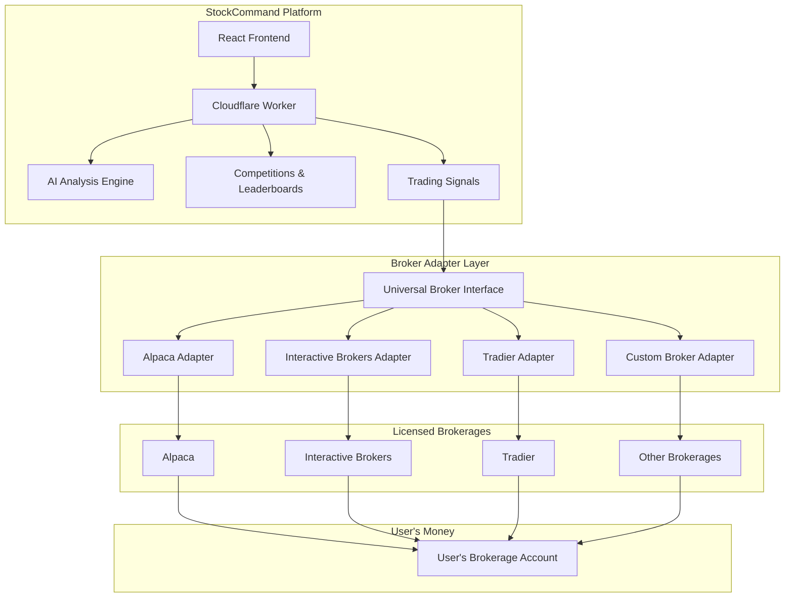

# StockCommand Broker Integration Architecture

## Vision

StockCommand is a **brokerage-agnostic** AI-powered trading platform. Any licensed brokerage can integrate with StockCommand, allowing their users to leverage our AI analysis, crowd wisdom, and competition system.

---

## Architecture Overview



---

## Universal Broker Interface

All broker adapters implement this interface:

```typescript
// lib/brokers/types.ts

interface BrokerAdapter {
  name: string;
  supportedAssets: ('stocks' | 'options' | 'crypto' | 'futures')[];
  
  // Authentication
  getAuthUrl(): string;
  handleCallback(code: string): Promise<BrokerCredentials>;
  
  // Account
  getAccount(): Promise<Account>;
  getPositions(): Promise<Position[]>;
  getBalances(): Promise<Balance>;
  
  // Orders
  placeOrder(order: OrderRequest): Promise<Order>;
  cancelOrder(orderId: string): Promise<void>;
  getOrders(status?: OrderStatus): Promise<Order[]>;
  
  // Market Data
  getQuote(symbol: string): Promise<Quote>;
  getBars(symbol: string, timeframe: Timeframe): Promise<Bar[]>;
}

interface OrderRequest {
  symbol: string;
  side: 'buy' | 'sell';
  type: 'market' | 'limit' | 'stop' | 'stop_limit';
  qty: number;
  limitPrice?: number;
  stopPrice?: number;
  timeInForce: 'day' | 'gtc' | 'ioc' | 'fok';
}

interface Position {
  symbol: string;
  qty: number;
  avgEntryPrice: number;
  currentPrice: number;
  unrealizedPL: number;
  unrealizedPLPercent: number;
}
```

---

## Supported Brokerages

### Tier 1 (MVP Priority)

| Broker | Assets | API Cost | Notes |
|--------|--------|----------|-------|
| **Alpaca** | Stocks, Crypto | Free | Most developer-friendly |
| **Interactive Brokers** | Everything | Free | Industry standard |

### Tier 2 (Post-MVP)

| Broker | Assets | API Cost | Notes |
|--------|--------|----------|-------|
| **Tradier** | Stocks, Options | Free | Options-focused |
| **TD Ameritrade** | Stocks, Options | Free | Large user base |
| **E*TRADE** | Stocks, Options | Free | Established broker |

### Tier 3 (Future)

| Broker | Assets | Notes |
|--------|--------|-------|
| **Robinhood** | Stocks, Crypto | Limited API access |
| **Webull** | Stocks, Crypto | API in development |
| **Fidelity** | Stocks | No public API yet |

---

## User Flow

### 1. Connect Brokerage

```
1. User clicks "Connect Brokerage" in StockCommand
2. User selects their broker (Alpaca, IBKR, etc.)
3. Redirect to broker's OAuth page
4. User authorizes StockCommand
5. Callback with auth tokens
6. Store encrypted credentials in D1
7. User's broker account now linked
```

### 2. View Portfolio

```
1. StockCommand calls broker adapter
2. Adapter fetches positions from broker API
3. Display holdings with real-time P&L
4. Overlay AI signals on positions
```

### 3. Execute Trade

```
1. AI generates trading signal
2. User reviews and approves (or auto-approve for premium)
3. StockCommand calls broker adapter
4. Adapter submits order to broker
5. Broker executes trade in user's account
6. StockCommand updates position display
```

---

## Database Schema Updates

```sql
-- User's connected brokerages
CREATE TABLE user_brokers (
    id TEXT PRIMARY KEY,
    user_id TEXT NOT NULL,
    broker_name TEXT NOT NULL, -- 'alpaca', 'ibkr', 'tradier'
    credentials_encrypted TEXT NOT NULL, -- Encrypted OAuth tokens
    is_active BOOLEAN DEFAULT true,
    connected_at INTEGER NOT NULL,
    last_sync INTEGER,
    FOREIGN KEY (user_id) REFERENCES users(id)
);

-- Trade history from connected brokers
CREATE TABLE trades (
    id TEXT PRIMARY KEY,
    user_id TEXT NOT NULL,
    broker_name TEXT NOT NULL,
    symbol TEXT NOT NULL,
    side TEXT NOT NULL, -- 'buy', 'sell'
    qty REAL NOT NULL,
    price REAL NOT NULL,
    signal_id TEXT, -- If trade came from StockCommand signal
    executed_at INTEGER NOT NULL,
    FOREIGN KEY (user_id) REFERENCES users(id)
);

-- Trading signals generated by AI
CREATE TABLE signals (
    id TEXT PRIMARY KEY,
    symbol TEXT NOT NULL,
    signal_type TEXT NOT NULL, -- 'BUY', 'SELL', 'HOLD'
    confidence REAL NOT NULL, -- 0.0 to 1.0
    reasoning TEXT,
    created_at INTEGER NOT NULL,
    expires_at INTEGER NOT NULL
);
```

---

## File Structure

```
lib/
└── brokers/
    ├── types.ts           # Universal interface
    ├── adapter.ts         # Base adapter class
    ├── registry.ts        # Broker registration
    ├── alpaca/
    │   ├── adapter.ts     # Alpaca implementation
    │   └── auth.ts        # Alpaca OAuth
    ├── ibkr/
    │   ├── adapter.ts     # IBKR implementation
    │   └── auth.ts        # IBKR OAuth
    └── tradier/
        ├── adapter.ts     # Tradier implementation
        └── auth.ts        # Tradier OAuth
```

---

## Security Considerations

### Credential Storage
- All broker credentials encrypted with AES-256 before storing in D1
- Encryption key stored as Cloudflare secret
- Credentials never logged or exposed to frontend

### API Key Scoping
- Request minimum permissions needed
- Read-only mode for Observer/Analyst tiers
- Trading permissions only for Strategist+

### Rate Limiting
- Respect each broker's rate limits
- Queue requests when approaching limits
- Graceful degradation during outages

---

## Monetization (Updated)

| Tier | Price | Broker Features |
|------|-------|-----------------|
| Observer | $9.99/mo | View signals only, no trading |
| Analyst | $14.99/mo | + Connect 1 broker, manual trades |
| Strategist | $24.99/mo | + Strategy builder, 2 brokers |
| Executor | $34.99/mo | + Semi-auto trading, 3 brokers |
| Autonomous | $49.99/mo | + Full auto-trading, unlimited brokers |

---

## Implementation Phases

### Phase 6A: Broker Abstraction Layer
- [ ] Create universal broker interface
- [ ] Build base adapter class
- [ ] Implement broker registry

### Phase 6B: Alpaca Integration
- [ ] Alpaca OAuth flow
- [ ] Account/positions endpoints
- [ ] Order submission
- [ ] Paper trading mode

### Phase 6C: IBKR Integration
- [ ] IBKR OAuth/Client Portal API
- [ ] Account/positions endpoints
- [ ] Order submission

### Phase 6D: UI Components
- [ ] Broker connection modal
- [ ] Multi-broker portfolio view
- [ ] Trade execution interface
- [ ] Signal-to-trade workflow

---

## Why This Approach?

1. **No Broker License Needed** - We're a software platform, not a broker
2. **User Choice** - Users pick their preferred broker
3. **Scalable** - Add new brokers without changing core logic
4. **Regulatory Safe** - We never touch user funds

---

## Next Steps

1. Create `lib/brokers/types.ts` with interface definitions
2. Implement Alpaca adapter (priority)
3. Add broker connection UI to ProfileModal
4. Build portfolio sync system
5. Implement signal-to-trade workflow
