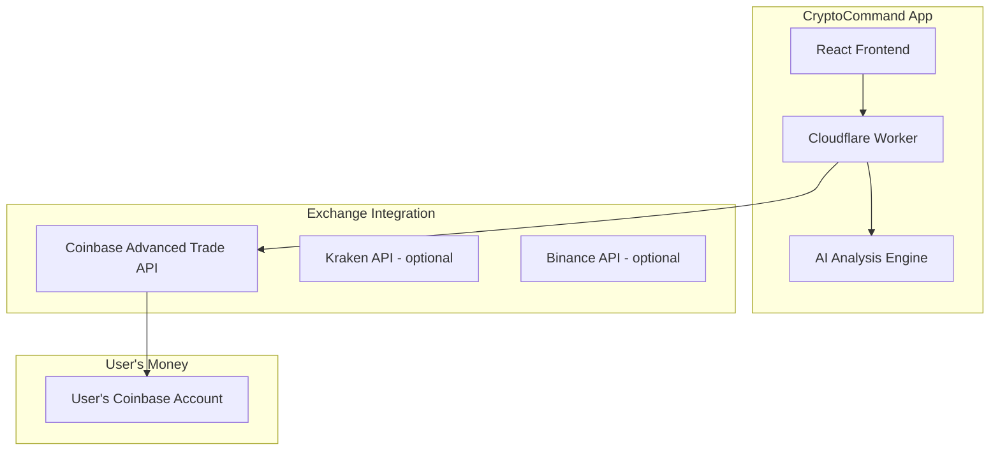

# CryptoCommand - Crypto-First Trading App Specification

> **NOTE**: This document is for a separate app to be built later. Save this file and remove it from the StockCommand repository.

---

## Overview

CryptoCommand is a dedicated crypto trading application that leverages the same AI/crowd wisdom architecture as StockCommand but focuses exclusively on cryptocurrency markets.

## Why Crypto-Only?

- **Lower regulatory burden** - No SEC/FINRA broker-dealer license required
- **24/7 markets** - Always-on trading opportunities
- **Faster MVP** - Single exchange integration vs. multiple brokerages
- **Already in UNIVERSE** - BTC, ETH, LINK, FIL, XRP already tracked

## Recommended Architecture



## Core Features

### 1. Exchange Connection
- User connects their Coinbase account via OAuth
- App gets API keys with trading permissions
- User's funds stay at Coinbase

### 2. AI Analysis (Reuse from StockCommand)
- Market clocks for crypto pairs
- Crowd wisdom from competition performance
- Agentic trading signals

### 3. Trade Execution
- Submit orders via Coinbase Advanced Trade API
- Support: Market, Limit, Stop-Loss orders
- Real-time position tracking

### 4. Portfolio Management
- View holdings across connected exchanges
- P&L tracking
- Performance history

## Coinbase Integration Details

### Required APIs
- **Coinbase OAuth 2.0** - User authentication
- **Advanced Trade API** - Order execution
- **WebSocket** - Real-time price data

### Permissions Needed
```
wallet:accounts:read
wallet:transactions:read
wallet:buys:create
wallet:sells:create
```

### Endpoints
```
POST /api/v3/brokerage/orders     # Place order
GET  /api/v3/brokerage/accounts   # List accounts
GET  /api/v3/brokerage/products   # List tradeable pairs
WS   wss://advanced-trade-ws.coinbase.com  # Real-time data
```

## Supported Crypto Assets

From existing UNIVERSE (Digital Rails sleeve):
| Symbol | Role |
|--------|------|
| BTC | Store of value |
| ETH | Smart contracts |
| LINK | Oracle |
| FIL | Decentralized storage |
| XRP | Settlement |

## Monetization

Same 5-tier structure as StockCommand:
| Tier | Price | Features |
|------|-------|----------|
| Observer | $9.99/mo | View signals, manual trading |
| Analyst | $14.99/mo | + Custom alerts |
| Strategist | $24.99/mo | + Strategy builder |
| Executor | $34.99/mo | + Semi-auto trading |
| Autonomous | $49.99/mo | Full auto-trading |

## Compliance Notes

### What You DON'T Need
- ❌ SEC/FINRA broker-dealer license
- ❌ SIPC insurance
- ❌ Custody infrastructure

### What You MIGHT Need
- ⚠️ Money Transmitter License (MTL) - **ONLY if you touch user funds**
- ⚠️ FinCEN MSB registration - **ONLY if operating as exchange**

### Safe Harbor
If your app:
1. Only sends API commands to Coinbase
2. Never holds user funds
3. User deposits/withdraws directly via Coinbase

Then you're likely operating as a **software tool**, not a money transmitter.

> **Consult a crypto-focused attorney before launch.**

## Tech Stack

Reuse from StockCommand:
- Cloudflare Workers + D1 + KV
- React frontend
- AI analysis engine
- Competition/leaderboard system

New additions:
- Coinbase OAuth integration
- Crypto-specific market clocks
- 24/7 monitoring capabilities

## Development Timeline

| Phase | Duration | Focus |
|-------|----------|-------|
| 1 | 2 weeks | Coinbase OAuth + account linking |
| 2 | 2 weeks | Order API integration |
| 3 | 2 weeks | AI signals for crypto |
| 4 | 2 weeks | Competitions + social |
| 5 | 2 weeks | Auto-trading (premium tiers) |

**Total: ~10 weeks to MVP**

## Repository Setup

When ready to start:
```bash
# Clone StockCommand as starting point
git clone https://github.com/amiddlebrook/StockCommand CryptoCommand
cd CryptoCommand

# Remove stock-specific code
# Update branding
# Add Coinbase integration
```

---

**This document should be removed from StockCommand repo after saving elsewhere.**
